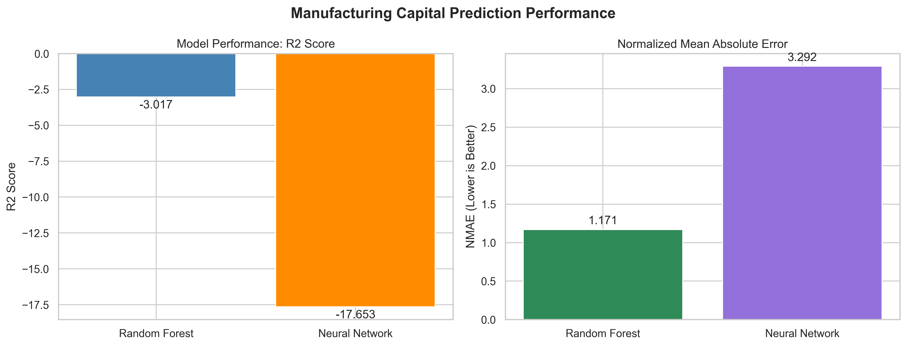
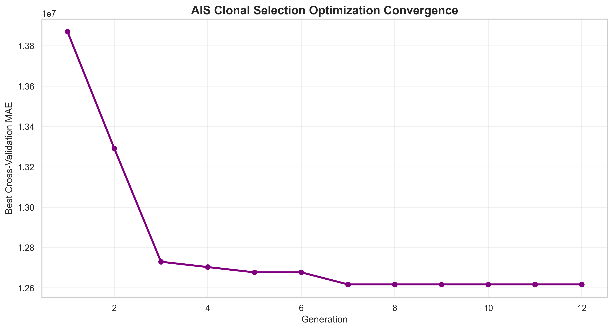
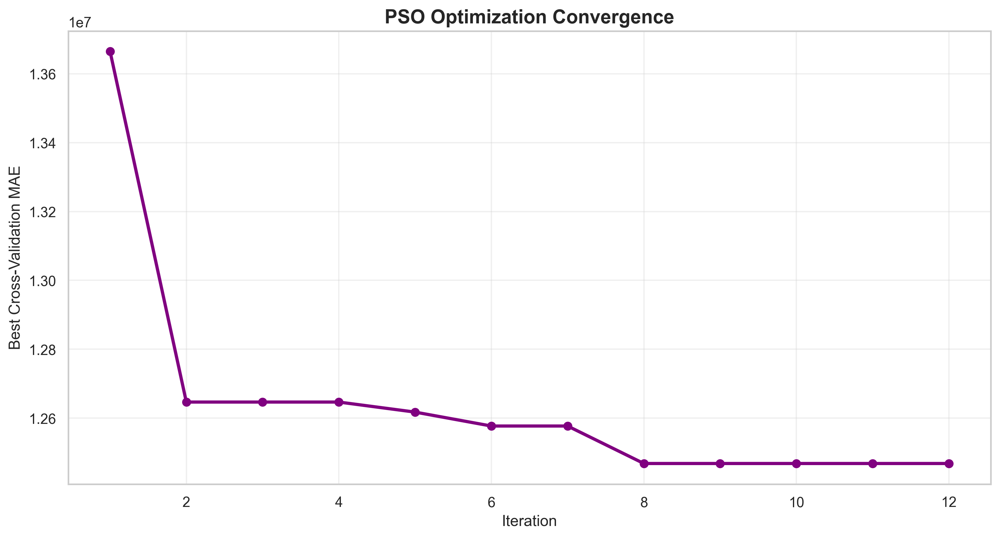

# AI-Based Manufacturing Company Capital and Registration Trend Analysis

## Machine Learning with Artificial Immune System (AIS) and Particle Swarm Optimization (PSO)

An AI-powered machine learning project designed to analyze manufacturing company capital structures, registration patterns, and financial characteristics using **Random Forest Regression, Artificial Neural Networks (ANN), Artificial Immune System (AIS), and Particle Swarm Optimization (PSO)**.

The system performs data preprocessing, feature engineering, capital analysis, predictive modeling, hyperparameter optimization, performance evaluation, and data visualization.

The project demonstrates how artificial intelligence and nature-inspired optimization algorithms can be applied to company registration and financial datasets.

---

## 1. Project Overview

Manufacturing companies play an important role in industrial development and economic growth. Analyzing their registration information, authorized capital, and paid-up capital can provide useful insights into company formation and financial structures.

This project develops an AI-based analytical framework to examine manufacturing company records and estimate paid-up capital using machine learning.

Three modeling approaches are investigated:

1. **Baseline Machine Learning:** Random Forest Regression and Artificial Neural Network.
2. **Artificial Immune System (AIS):** Clonal Selection Algorithm for Random Forest hyperparameter optimization.
3. **Particle Swarm Optimization (PSO):** Swarm intelligence-based Random Forest hyperparameter optimization.

The project compares these approaches using regression evaluation metrics and generates graphical reports.

### Main Objectives

- Analyze manufacturing company capital structures.
- Examine company registration characteristics.
- Calculate capital utilization ratios.
- Identify relationships between financial and registration variables.
- Predict company paid-up capital using machine learning.
- Optimize Random Forest hyperparameters using AIS.
- Optimize Random Forest hyperparameters using PSO.
- Compare baseline, AIS, and PSO model performance.
- Generate prediction results and graphical visualizations.
- Save trained models and experimental configurations.

---

## 2. Project Visualization

### Baseline Machine Learning Performance

**Figure 1:** Baseline machine learning performance visualization using the R² score and normalized mean absolute error (NMAE).

The graph compares Random Forest and Artificial Neural Network performance.

Higher R² values generally indicate better regression fit, while lower normalized MAE values indicate smaller prediction errors.

Since the problem involves predicting continuous financial values, regression metrics are used instead of classification accuracy.

### Additional Visualizations

| Visualization | Description |
|---|---|
| `accuracy_graph.png` | Baseline model performance |
| `heatmap.png` | Financial and registration feature correlations |
| `comparison_graph.png` | Random Forest and ANN comparison |
| `result_graph.png` | Actual versus predicted capital |
| `prediction_graph.png` | Baseline prediction visualization |
| `ais_accuracy_graph.png` | AIS model performance |
| `ais_comparison_graph.png` | Baseline versus AIS comparison |
| `ais_convergence_graph.png` | AIS optimization convergence |
| `pso_accuracy_graph.png` | PSO model performance |
| `pso_comparison_graph.png` | Baseline versus PSO comparison |
| `pso_convergence_graph.png` | PSO optimization convergence |

---

## 3. Problem Statement

Traditional company registration datasets contain valuable financial and administrative information. However, extracting useful insights from these records often requires substantial data processing and statistical analysis.

Machine learning can help identify relationships between company characteristics and capital values.

The primary research problem is:

**Can machine learning models estimate manufacturing company paid-up capital using registration and financial attributes, and can AIS and PSO improve the predictive performance of Random Forest Regression?**

The project addresses this problem through data preprocessing, predictive modeling, and optimization-based experimentation.

---

## 4. Dataset Description

The project uses a CSV dataset containing manufacturing company registration and financial information.

### Dataset File

`4dbe5667-7b6b-41d7-82af-211562424d9a.csv`

### Dataset Characteristics

| Property | Description |
|---|---|
| Dataset type | Manufacturing company registration records |
| File format | CSV |
| Original records | 10 |
| Original attributes | 16 |
| Prediction target | PaidupCapital |
| Learning approach | Supervised regression |
| Industry focus | Manufacturing / machinery and equipment |

### Important Attributes

| Attribute | Description |
|---|---|
| CompanyName | Registered company name |
| AuthorizedCapital | Authorized share capital |
| PaidupCapital | Paid-up share capital |
| CompanyRegistrationdate_date | Company registration date |
| CompanyStateCode | State registration code |
| CompanyClass | Company classification |
| CompanyCategory | Company category |
| CompanySubCategory | Company subcategory |
| CompanyStatus | Company status |
| CompanyIndustrialClassification | Industrial classification |

Only available and suitable columns are selected for model training.

### Prediction Target

The target variable is:

`PaidupCapital`

The models estimate paid-up capital from authorized capital, registration date features, and available categorical company attributes.

### Dataset Limitation

The dataset contains only 10 records.

Consequently, this project should be considered an exploratory proof of concept rather than a production-ready financial forecasting system.

A larger dataset is necessary to establish statistically reliable model performance.

---

## 5. Technologies Used

### Programming Language

- Python 3.10 or later

### Data Processing

- Pandas
- NumPy

### Machine Learning

- Scikit-learn
- Random Forest Regressor
- Artificial Neural Network

### Deep Learning

- TensorFlow
- Keras

### Optimization

- Artificial Immune System (AIS)
- Clonal Selection Algorithm (CLONALG)
- Particle Swarm Optimization (PSO)

### Data Visualization

- Matplotlib
- Seaborn

### Model Storage

- Joblib
- HDF5 (`.h5`)
- YAML
- JSON

### Development Environment

- Jupyter Notebook
- Visual Studio Code
- Windows

---

## 6. System Architecture

The project follows the workflow below:

    Input Manufacturing Company CSV
                  |
                  v
         Dataset Inspection
                  |
                  v
        Data Preprocessing
                  |
                  v
         Feature Engineering
                  |
                  v
          Train-Test Split
                  |
                  v
        Machine Learning Models
                  |
          +-------+-------+
          |               |
          v               v
     Random Forest       ANN
          |
          v
     Hyperparameter Optimization
          |
       +--+--+
       |     |
       v     v
      AIS   PSO
       |     |
       +--+--+
          |
          v
       Evaluation
          |
          v
      Visualization
          |
          v
     CSV / PNG / PKL / H5
     YAML / JSON Outputs

---

## 7. Data Preprocessing

Data preprocessing is performed to prepare the manufacturing company records for machine learning.

### 7.1 Missing Value Handling

Missing numeric values are handled using median imputation.

Missing categorical values are handled using suitable categorical preprocessing.

Records without a valid target value are excluded from supervised model training.

### 7.2 Data Type Conversion

Capital attributes are converted into numeric data types.

Registration dates are converted into datetime format.

### 7.3 Categorical Encoding

Categorical company attributes are transformed using One-Hot Encoding.

Unknown categories are handled during prediction.

### 7.4 Feature Scaling

Numerical features are standardized using StandardScaler where applicable.

The neural network target variable is also scaled during training and converted back to its original units for evaluation.

### 7.5 Data Splitting

The dataset is divided into:

- Training data: 80%
- Testing data: 20%

The random seed is fixed at 42 for reproducibility.

The same split is used across the baseline, AIS, and PSO experiments.

---

## 8. Feature Engineering

Registration dates are transformed into additional features.

### Registration Year

Extracts the year in which a company was registered.

### Registration Month

Extracts the registration month.

### Registration Day

Extracts the day of registration.

### Capital Utilization Ratio

Capital utilization is calculated as:

\[
Capital\ Utilization =
\frac{PaidupCapital}{AuthorizedCapital}
\times 100
\]

This ratio provides descriptive information about the relationship between authorized and paid-up capital.

**Important:** Capital utilization is excluded from the prediction features because it directly contains the target variable. Including it would introduce target leakage.

---

## 9. Baseline Machine Learning Models

### 9.1 Random Forest Regressor

Random Forest is an ensemble learning algorithm that combines predictions from multiple decision trees.

It is used to estimate company paid-up capital from financial and registration features.

#### Initial Configuration

| Parameter | Value |
|---|---|
| Algorithm | Random Forest Regressor |
| Number of trees | 100 |
| Maximum depth | 4 |
| Random state | 42 |

### Advantages

- Handles nonlinear relationships.
- Supports mixed numerical and encoded categorical data.
- Provides a useful baseline for optimization.
- Requires relatively little feature scaling.

### 9.2 Artificial Neural Network

A feedforward neural network is implemented using TensorFlow/Keras.

#### Architecture

| Layer | Neurons | Activation |
|---|---|---|
| Input | Depends on encoded features | — |
| Hidden Layer 1 | 32 | ReLU |
| Hidden Layer 2 | 16 | ReLU |
| Hidden Layer 3 | 8 | ReLU |
| Output | 1 | Linear |

#### Training Configuration

| Parameter | Value |
|---|---|
| Optimizer | Adam |
| Learning rate | 0.001 |
| Loss function | Mean Squared Error |
| Maximum epochs | 200 |
| Batch size | 2 |
| Early stopping | Enabled |

The neural network predicts a continuous paid-up capital value.

---

## 10. Artificial Immune System (AIS)

Artificial Immune System is a nature-inspired computational approach based on principles of the biological immune system.

This project implements a Clonal Selection Algorithm to optimize Random Forest hyperparameters.

### AIS Working Principle

1. Generate an initial population of candidate solutions called antibodies.
2. Evaluate each antibody using cross-validation MAE.
3. Select the best-performing antibodies.
4. Clone selected antibodies.
5. Apply hypermutation to create new candidate solutions.
6. Retain strong candidates and introduce random replacements.
7. Repeat the process over multiple generations.
8. Select the best hyperparameter combination.

### AIS Configuration

| Parameter | Value |
|---|---|
| Population size | 8 |
| Generations | 12 |
| Selected antibodies | 4 |
| Clones per antibody | 3 |
| Random replacements | 2 |
| Fitness objective | Minimize CV MAE |

### Optimized Hyperparameters

AIS optimizes:

- `n_estimators`
- `max_depth`
- `min_samples_split`
- `min_samples_leaf`

### AIS Fitness Function

\[
Fitness(\theta) =
\frac{1}{K}
\sum_{k=1}^{K}
MAE_k(\theta)
\]

Where:

- \(\theta\) represents Random Forest hyperparameters.
- \(K\) represents the number of cross-validation folds.
- \(MAE_k\) represents validation error in fold \(k\).

The objective is to minimize average cross-validation MAE.

### AIS Visualization

**Figure 2:** AIS optimization convergence showing the best cross-validation MAE across generations.

The optimized Random Forest model is saved as:

`ais_model.pkl`

---

## 11. Particle Swarm Optimization (PSO)

Particle Swarm Optimization is a population-based optimization technique inspired by the collective movement of birds and fish.

In this project, each particle represents a candidate Random Forest hyperparameter configuration.

### PSO Working Principle

1. Initialize a swarm of particles.
2. Assign a position and velocity to each particle.
3. Evaluate particle fitness using cross-validation MAE.
4. Update each particle's personal best solution.
5. Update the global best solution.
6. Modify particle velocities and positions.
7. Repeat until the maximum number of iterations is reached.
8. Train the final Random Forest using optimized parameters.

### Velocity Update Equation

\[
v_i^{t+1} =
wv_i^t +
c_1r_1(pbest_i-x_i^t) +
c_2r_2(gbest-x_i^t)
\]

### Position Update Equation

\[
x_i^{t+1}=x_i^t+v_i^{t+1}
\]

Where:

- \(w\): Inertia weight
- \(c_1\): Cognitive coefficient
- \(c_2\): Social coefficient
- \(r_1,r_2\): Random values
- \(pbest\): Personal best position
- \(gbest\): Global best position

### PSO Configuration

| Parameter | Value |
|---|---|
| Number of particles | 8 |
| Maximum iterations | 12 |
| Inertia weight | 0.7 |
| Cognitive coefficient | 1.5 |
| Social coefficient | 1.5 |
| Optimization objective | Minimize CV MAE |

### PSO Visualization

**Figure 3:** PSO convergence showing the best cross-validation MAE across optimization iterations.

The optimized model is saved as:

`pso_model.pkl`

---

## 12. Model Evaluation Metrics

The project evaluates regression models using the following metrics.

### 12.1 Mean Absolute Error (MAE)

\[
MAE = \frac{1}{n}
\sum_{i=1}^{n}|y_i-\hat{y}_i|
\]

MAE measures the average absolute difference between actual and predicted paid-up capital.

Lower MAE indicates better performance.

### 12.2 Mean Squared Error (MSE)

\[
MSE = \frac{1}{n}
\sum_{i=1}^{n}(y_i-\hat{y}_i)^2
\]

MSE penalizes large prediction errors more strongly.

### 12.3 Root Mean Squared Error (RMSE)

\[
RMSE = \sqrt{MSE}
\]

RMSE measures prediction error in the original capital units.

### 12.4 R-Squared Score

\[
R^2 =
1 -
\frac{\sum(y_i-\hat{y}_i)^2}
{\sum(y_i-\bar{y})^2}
\]

R² measures the proportion of target variance explained by the model relative to a mean-prediction baseline.

R² can be negative when a model performs worse than predicting the test-set mean.

### 12.5 Normalized Mean Absolute Error

\[
NMAE =
\frac{MAE}{mean(|y|)}
\]

NMAE expresses the absolute prediction error relative to the mean absolute target value.

Lower NMAE indicates better performance.

---

## 13. Model Comparison

The project evaluates the following models:

| Model | Optimization | Evaluation |
|---|---|---|
| Random Forest | None | MAE, MSE, RMSE, R², NMAE |
| Artificial Neural Network | Adam training | MAE, MSE, RMSE, R², NMAE |
| AIS Random Forest | Clonal Selection | MAE, MSE, RMSE, R², NMAE |
| PSO Random Forest | Particle Swarm Optimization | MAE, MSE, RMSE, R², NMAE |

The experimental results are saved in:

- `results.csv`
- `ais_results.csv`
- `pso_results.csv`

These files contain the measured performance values generated during execution.

No specific algorithm is assumed to outperform the others before evaluation.

---

## 14. Project Directory Structure

    AI-Based Manufacturing Company Capital and Registration Trend Analysis/
    |
    |-- 4dbe5667-7b6b-41d7-82af-211562424d9a.csv
    |
    |-- README.md
    |
    |-- manufacturing_model.h5
    |-- manufacturing_model.pkl
    |-- manufacturing_config.yaml
    |-- manufacturing_metadata.json
    |
    |-- accuracy_graph.png
    |-- heatmap.png
    |-- comparison_graph.png
    |-- result_graph.png
    |-- prediction_graph.png
    |-- results.csv
    |-- prediction.csv
    |
    |-- ais_model.pkl
    |-- ais_config.yaml
    |-- ais_metadata.json
    |
    |-- ais_accuracy_graph.png
    |-- ais_heatmap.png
    |-- ais_comparison_graph.png
    |-- ais_result_graph.png
    |-- ais_prediction_graph.png
    |-- ais_convergence_graph.png
    |
    |-- ais_results.csv
    |-- ais_prediction.csv
    |-- ais_optimization_history.csv
    |
    |-- pso_model.pkl
    |-- pso_config.yaml
    |-- pso_metadata.json
    |
    |-- pso_accuracy_graph.png
    |-- pso_heatmap.png
    |-- pso_comparison_graph.png
    |-- pso_result_graph.png
    |-- pso_prediction_graph.png
    |-- pso_convergence_graph.png
    |
    |-- pso_results.csv
    |-- pso_prediction.csv
    |-- pso_optimization_history.csv

---

## 15. Installation and Setup

### Step 1: Install Python

Install Python 3.10 or a compatible version supported by your TensorFlow installation.

Verify installation:

    python --version

### Step 2: Install Required Libraries

Run:

    pip install numpy pandas scikit-learn tensorflow matplotlib seaborn joblib pyyaml h5py

### Step 3: Prepare Project Directory

Create the project folder:

    C:\Users\sagni\Downloads\AI-Based Manufacturing Company Capital and Registration Trend Analysis

Place the dataset inside the folder.

### Step 4: Configure Dataset Path

In the Python code, define:

    PROJECT_DIR = r"C:\Users\sagni\Downloads\AI-Based Manufacturing Company Capital and Registration Trend Analysis"

    CSV_PATH = os.path.join(
        PROJECT_DIR,
        "4dbe5667-7b6b-41d7-82af-211562424d9a.csv"
    )

### Step 5: Run Baseline Model

Execute the baseline machine learning training code.

This generates:

- Trained Random Forest model
- Trained neural network
- Preprocessing pipelines
- YAML configuration
- JSON metadata

### Step 6: Generate Baseline Visualizations

Run the baseline visualization code.

This produces the performance graphs, heatmap, comparison graph, results CSV, and prediction CSV.

### Step 7: Run AIS Optimization

Execute the AIS implementation.

The algorithm performs Clonal Selection optimization and saves all AIS outputs using the `ais_` prefix.

### Step 8: Run PSO Optimization

Execute the PSO implementation.

The algorithm performs particle swarm optimization and saves all PSO outputs using the `pso_` prefix.

### Step 9: Review Results

Compare:

- Baseline Random Forest
- Artificial Neural Network
- AIS-optimized Random Forest
- PSO-optimized Random Forest

Review the generated graphs and CSV files to examine prediction errors and optimization behavior.

---

## 16. Expected Outputs

### Baseline Outputs

The baseline workflow generates:

- Trained machine learning models
- Regression performance metrics
- Feature correlation heatmap
- Actual versus predicted graphs
- Prediction CSV
- Results CSV

### AIS Outputs

The AIS workflow generates:

- Optimized Random Forest model
- Best antibody hyperparameters
- Optimization history
- Convergence graph
- Prediction CSV
- Evaluation graphs
- YAML configuration
- JSON metadata

### PSO Outputs

The PSO workflow generates:

- Optimized Random Forest model
- Best particle hyperparameters
- Optimization history
- Convergence graph
- Prediction CSV
- Evaluation graphs
- YAML configuration
- JSON metadata

---

## 17. Applications

### Financial Data Analysis

Analyze relationships between authorized capital and paid-up capital.

### Company Registration Analysis

Examine company registration years and related attributes.

### Predictive Analytics

Experiment with estimating paid-up capital from company characteristics.

### Machine Learning Research

Compare ensemble learning and neural network regression.

### Optimization Research

Study the effectiveness of AIS and PSO for hyperparameter optimization.

### Academic Projects

Use the implementation as an educational demonstration of data preprocessing, regression, optimization, and visualization.

---

## 18. Advantages

- Integrates machine learning and nature-inspired optimization.
- Supports numerical and categorical company attributes.
- Uses reusable preprocessing pipelines.
- Separates training and testing data.
- Performs cross-validation during hyperparameter optimization.
- Provides multiple model comparison visualizations.
- Saves model artifacts for later use.
- Automatically exports results in CSV format.
- Uses reproducible random seeds.
- Supports future expansion to larger datasets.

---

## 19. Limitations

### Small Dataset

The current dataset contains only 10 company records.

The 80/20 split leaves approximately eight training records and two testing records.

Performance estimates from such a small test set are highly unstable.

### Limited Generalization

Models trained on a small sample may not generalize to other manufacturing companies.

### Optimization Overfitting

AIS and PSO may select hyperparameters that perform well on a very small cross-validation sample without improving generalization.

### Limited Temporal Analysis

Registration trends derived from a small sample cannot establish meaningful industry-wide trends.

### No External Validation

The project does not include validation against a separate, larger external dataset.

### Financial Interpretation

Paid-up capital predictions are statistical estimates, not investment recommendations or verified financial forecasts.

---

## 20. Future Enhancements

The project can be extended through:

1. **Larger Datasets:** Include thousands of manufacturing company records.
2. **Advanced Regression Models:** Implement XGBoost, LightGBM, CatBoost, and Gradient Boosting.
3. **Hybrid Optimization:** Explore combined AIS-PSO optimization.
4. **Explainable AI:** Integrate SHAP for feature contribution analysis.
5. **Time-Series Analysis:** Analyze registration trends using historical data.
6. **Interactive Dashboard:** Develop a Streamlit application.
7. **Geographical Analysis:** Visualize state-wise company registration patterns.
8. **Model Validation:** Apply repeated cross-validation and independent holdout datasets.
9. **Automated Reporting:** Generate PDF and Excel analytical reports.
10. **Deployment:** Deploy the prediction pipeline through a REST API.

---

## 21. Research Significance

This project demonstrates the integration of machine learning and nature-inspired optimization for financial data analysis.

The baseline models provide a reference for evaluating optimized approaches.

AIS explores the hyperparameter search space through immune-inspired selection, cloning, and mutation.

PSO explores the same search space through particle movement guided by personal and global best solutions.

Comparing the approaches helps illustrate differences between optimization strategies.

Because the available dataset is extremely small, the primary contribution is the implementation and evaluation framework rather than a demonstrated improvement in financial prediction accuracy.

---

## 22. Conclusion

The **AI-Based Manufacturing Company Capital and Registration Trend Analysis** project presents a machine learning framework for examining manufacturing company financial and registration information.

The system integrates Random Forest Regression, Artificial Neural Networks, Artificial Immune System optimization, and Particle Swarm Optimization.

It performs data preprocessing, feature engineering, regression modeling, optimization, evaluation, and visualization.

The implementation also generates reusable models, configuration files, prediction CSV files, and graphical outputs.

The project provides a foundation for future research involving larger manufacturing company datasets, advanced predictive models, and hybrid optimization algorithms.

---

## 23. Keywords

Artificial Intelligence, Machine Learning, Manufacturing Companies, Authorized Capital, Paid-up Capital, Company Registration, Random Forest Regression, Artificial Neural Network, Artificial Immune System, Clonal Selection Algorithm, Particle Swarm Optimization, Financial Data Analysis, Predictive Analytics, Hyperparameter Optimization, Python.

---

## 24. Disclaimer

This project is intended for educational, experimental, and research purposes.

The dataset contains a very limited number of records, and the resulting predictions should not be used for financial, investment, regulatory, or business decisions without additional data and independent validation.

---

## 25. License

This project may be distributed under the MIT License if the project owner chooses to apply that license.

The original dataset remains subject to its own applicable usage and redistribution terms.
